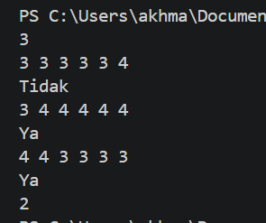

# <h1 align="center">Laporan Praktikum Modul 05 - Perulangan For Loop</h1>

<p align="center">Akhmad Nizar - 109092600018</p>

## Dasar Teori

### A. Pengenalan For Loop di GO

Perulangan adalah proses mengulang-ulang eksekusi blok kode tanpa henti, selama kondisi yang dijadikan acuan terpenuhi. Biasanya disiapkan variabel untuk iterasi atau variabel penanda kapan perulangan akan diberhentikan.

### B. Beberapa cara penggunaan For Loop di GO

#### 1. Perulangan Menggunakan Keyword for

Ada beberapa cara standar menggunakan for. Cara pertama dengan memasukkan variabel counter perulangan beserta kondisinya setelah keyword. Perhatikan dan praktikkan kode berikut.

    for i := 0; i < 5; i++ {
    	fmt.Println("Angka", i)
    }

Perulangan di atas hanya akan berjalan ketika variabel i bernilai di bawah 5, dengan ketentuan setiap kali perulangan, nilai variabel i akan di-iterasi atau ditambahkan 1 (i++ artinya ditambah satu, sama seperti i = i + 1). Karena i pada awalnya bernilai 0, maka perulangan akan berlangsung 5 kali, yaitu ketika i bernilai 0, 1, 2, 3, dan 4.

#### 2. Penggunaan Keyword for Dengan Argumen Hanya Kondisi

Cara ke-2 adalah dengan menuliskan kondisi setelah keyword for (hanya kondisi). Deklarasi dan iterasi variabel counter tidak dituliskan setelah keyword, hanya kondisi perulangan saja. Konsepnya mirip seperti while milik bahasa pemrograman lain.

Kode berikut adalah contoh for dengan argumen hanya kondisi (seperti if), output yang dihasilkan sama seperti penerapan for cara pertama.

    var i = 0

    for i < 5 {
    	fmt.Println("Angka", i)
    	i++
    }

#### 3. Penggunaan Keyword for Tanpa Argumen

Cara ke-3 adalah for ditulis tanpa kondisi. Dengan ini akan dihasilkan perulangan tanpa henti (sama dengan for true). Pemberhentian perulangan dilakukan dengan menggunakan keyword break.

    var i = 0

    for {
    	fmt.Println("Angka", i)

    	i++
    	if i == 5 {
    		break
    	}
    }

Dalam perulangan tanpa henti di atas, variabel i yang nilai awalnya 0 di-inkrementasi. Ketika nilai i sudah mencapai 5, keyword break digunakan, dan perulangan akan berhenti.

#### 4. Penggunaan Keyword for - range

Cara ke-4 adalah perulangan dengan menggunakan kombinasi keyword for dan range. Cara ini biasa digunakan untuk me-looping data gabungan (misalnya string, array, slice, map). Detailnya akan dibahas dalam chapter-chapter selanjutnya (A.15. Array, A.16. Slice, A.17. Map).

    var xs = "123" // string
    for i, v := range xs {
    	fmt.Println("Index=", i, "Value=", v)
    }

    var ys = [5]int{10, 20, 30, 40, 50} // array
    for _, v := range ys {
    	fmt.Println("Value=", v)
    }

    var zs = ys[0:2] // slice
    for _, v := range zs {
    	fmt.Println("Value=", v)
    }

    var kvs = map[byte]int{'a': 0, 'b': 1, 'c': 2} // map
    for k, v := range kvs {
    	fmt.Println("Key=", k, "Value=", v)
    }

    // boleh juga baik k dan atau v nya diabaikan
    for range kvs {
    	fmt.Println("Done")
    }

    // selain itu, bisa juga dengan cukup menentukan nilai numerik perulangan
    // (fitur ini tersedia sejak Go 1.22)
    for i := range 5 {
    	fmt.Print(i) // 01234
    }

#### 5. Penggunaan Keyword break & continue

Keyword break digunakan untuk menghentikan secara paksa sebuah perulangan, sedangkan continue dipakai untuk memaksa maju ke perulangan berikutnya.

Berikut merupakan contoh penerapan continue dan break. Kedua keyword tersebut dimanfaatkan untuk menampilkan angka genap berurutan yang lebih besar dari 0 dan kurang dari atau sama dengan 8.

    for i := 1; i <= 10; i++ {
    	if i%2 == 1 {
    		continue
    	}

    	if i > 8 {
    		break
    	}

    	fmt.Println("Angka", i)
    }

Kode di atas akan lebih mudah dicerna jika dijelaskan secara berurutan. Berikut adalah penjelasannya.

Dilakukan perulangan mulai angka 1 hingga 10 dengan i sebagai variabel iterasi.
Ketika i adalah ganjil (dapat diketahui dari i % 2, jika hasilnya 1, berarti ganjil), maka akan dipaksa lanjut ke perulangan berikutnya.
Ketika i lebih besar dari 8, maka perulangan akan berhenti.
Nilai i ditampilkan.

#### 6. Perulangan Bersarang

Tak hanya seleksi kondisi yang bisa bersarang, perulangan juga bisa. Cara pengaplikasiannya kurang lebih sama, tinggal tulis blok statement perulangan di dalam perulangan.

    for i := 0; i < 5; i++ {
    	for j := i; j < 5; j++ {
    		fmt.Print(j, " ")
    	}

    	fmt.Println()
    }

Pada kode di atas, untuk pertama kalinya fungsi fmt.Println() dipanggil tanpa disisipkan parameter. Cara seperti ini bisa digunakan untuk menampilkan baris baru. Kegunaannya sama seperti output dari statement fmt.Print("\n").

## Guided

### 1. tabungan.go

```go
package main

import "fmt"

func main() {
	var a, b, n int
	fmt.Scan(&a, &b, &n)

	total := 0
	tabungan := a

	for i := 1; i <= n; i++ {
		total += tabungan
		tabungan += b
	}

	fmt.Println(total)
}

```

#### Deskripsi

Program di atas adalah tabungan yang dimana nilai yang diinputkan akan disimpan ke dalam variable a, b dan n lalu dijumlahkan menggunakan perulangan for. 1000 + 1500 + 2000 + 2500 + 3000 = 10000

##### Output


### 2. terbesar.go

```go
package main

import "fmt"

func main() {
	var n, bil, terbesar int
	fmt.Print("Masukkan n: ")
	fmt.Scan(&n)

	for i := 1; i <= n; i++ {
		fmt.Print("Masukkan bilangan: ")
		fmt.Scan(&bil)

		if i == 1 || bil > terbesar {
			terbesar = bil
		}
	}

	fmt.Println("Keluaran: ", terbesar)
}

```

##### Output


#### Deskripsi

Di atas ialah program dalam bahasa Go untuk mencari bilangan terbesar dari n buah bilangan bulat yang diinputkan menggunakan perulangan for.

### 3. bioskop.go

```go
package main

import "fmt"

func main() {
	var t int
	fmt.Print("Masukkan jumlah transaksi: ")
	fmt.Scan(&t)

	totalPendapatan := 0

	for i := 1; i <= t; i++ {
		var film, hari string
		var tiket, harga, total int

		fmt.Print("Masukkan film: ")
		fmt.Scan(&film)
		fmt.Print("Masukkan hari: ")
		fmt.Scan(&hari)
		fmt.Print("Masukkan jumlah tiket: ")
		fmt.Scan(&tiket)

		switch film {
		case "Reguler":
			if hari == "Senin" || hari == "Selasa" || hari == "Rabu" || hari == "Kamis" {
				harga = 40000
			} else {
				harga = 50000
			}
		case "3D":
			if hari == "Senin" || hari == "Selasa" || hari == "Rabu" || hari == "Kamis" {
				harga = 60000
			} else {
				harga = 70000
			}
		case "IMAX":
			if hari == "Senin" || hari == "Selasa" || hari == "Rabu" || hari == "Kamis" {
				harga = 80000
			} else {
				harga = 90000
			}
		}

		total = harga * tiket

		if tiket >= 5 {
			total = total - total*10/100
		}

		fmt.Println("Total: ", total)
		totalPendapatan += total
	}

	fmt.Println("Total Pendapatan: ", totalPendapatan)
}

```

##### Output


#### Deskripsi

Di atas ialah program dalam bahasa Go untuk menghitung total pendapatan dari beberapa transaksi pembelian tiket dalam satu periode. Program di atas membaca sejumlah transaksi, lalu untuk setiap transaksi menghitung total harga berdasarkan jenis film, hari pemutaran, dan jumlah tiket yang dibeli. Jika pembelian dalam satu transaksi ≥ 5 tiket, pelanggan mendapatkan diskon 10% dari total harga transaksi tersebut.

## Unguided

### 1. prima.go

```go
package main

import "fmt"

func main() {
	var n int
	var faktor int

	fmt.Scan(&n)

	for i := 1; i <= n; i++ {
		if n%i == 0 {
			fmt.Print(i, " ")
			faktor++
		}
	}

	fmt.Println()

	if faktor == 2 {
		fmt.Println("Ya")
	} else {
		fmt.Println("Tidak")
	}
}

```

##### Output


#### Deskripsi

Program di atas membaca input n lalu menampilkan seluruh faktor dari sebuah bilangan bulat positif n, kemudian menentukan apakah n merupakan bilangan prima atau bukan.

### 2. ecct.go

```go
package main

import "fmt"

func main() {
	var m int
	var jumlah int

	fmt.Scan(&m)

	for i := 1; i <= m; i++ {
		var p, v, ga, fs, ci, tc int

		fmt.Scan(&p, &v, &ga, &fs, &ci, &tc)

		total := p + v + ga + fs + ci + tc

		if float64(total)/6 >= 3.33 {
			fmt.Println("Ya")
			jumlah++
		} else {
			fmt.Println("Tidak")
		}
	}

	fmt.Println(jumlah)
}

```

##### Output



#### Deskripsi

Program menentukan apakah setiap mahasiswa baru Tel-U dalam satu kelompok bisa mendapat sertifikat ECCT atau tidak. Syarat mendapat sertifikat ECCT adalah rata-rata nilai tes ECCT minimal 3.33. Selain itu, program juga menghitung berapa banyak mahasiswa yang mendapat sertifikat.

## Kesimpulan

Praktikum ini bertujuan untuk memahami perulangan for serta implementasinya dalam coding.

## Referensi

1. Noval Agung. (2021). _novalagung.com_.
